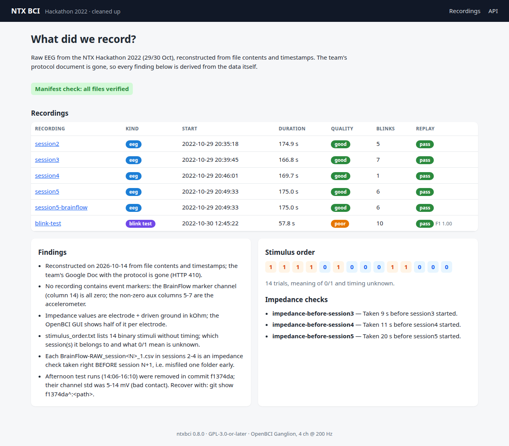
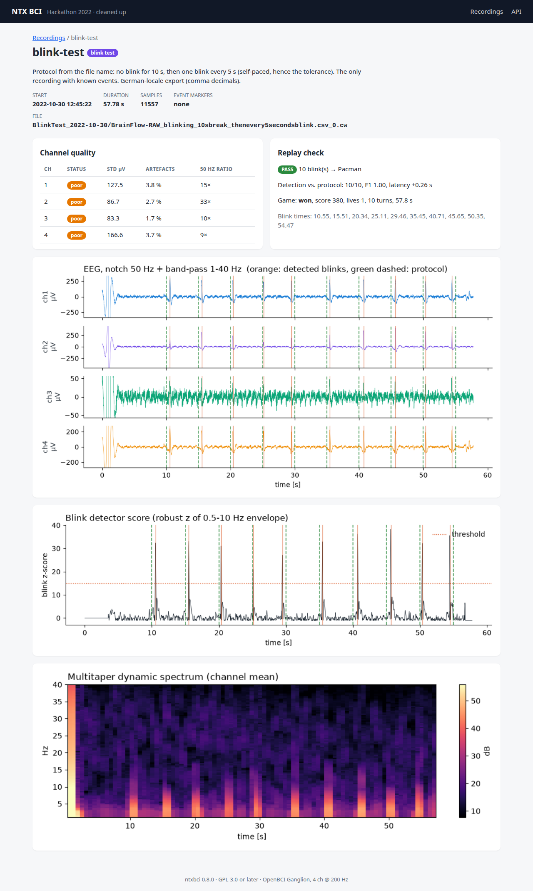

# NTXHackathon22

[](https://github.com/marcelpetrick/NTXHackathon22/actions/workflows/local-pipeline.yml)
[](https://github.com/marcelpetrick/NTXHackathon22/actions/workflows/docker-publish.yml)
[](https://github.com/marcelpetrick/NTXHackathon22/pkgs/container/ntxhackathon22)
[](LICENSE)
[](https://www.python.org/)
[](https://fastapi.tiangolo.com/)
[](pyproject.toml)

`ntxbci` is the cleaned-up result of our [NeuroTechX Hackathon 2022](https://web.archive.org/web/20220919091253/https://neurotechx.com/hackathon2022/)
project (29/30 October 2022). We recorded EEG with an **OpenBCI Ganglion** (4 channels, 200 Hz)
to steer a one-row **Pacman** with blinks, and stopped with raw files nobody could explain
any more. This repository turns those leftovers into a working toolkit:

- a verified **manifest** that explains every recording (the "mystery" solved, see below),
- **loaders** for all three Ganglion export formats, **filtering**, **quality** metrics,
- a **blink detector** validated against the one recording with known events (F1 = 1.0),
- **epoching** under explicit trial-timing hypotheses, multitaper **dynamic spectra**,
- the **Pacman** game, rewritten and controllable by keyboard or replayed blinks,
- an automated **replay check**: recording → detector → game, verified end to end,
- a **web dashboard**, a **CLI**, a runnable **notebook** and a **docker image**.

**Author: Marcel Petrick <mail@marcelpetrick.it>** (hackathon team: Shuhong Huang, Thomas Mullen, Marcel Petrick)

**License: GPLv3 or later. See [`LICENSE`](LICENSE).** Original 2022 contributions keep their MIT notice in [`LICENSES/`](LICENSES/).

**Note: the cleanup is generated with AI.**



## What did we record?

Reconstructed from file contents and timestamps (the team's Google Doc with the protocol is gone):

| Recording | When (CEST) | What it really is |
|---|---|---|
| `session2`–`session5` | 2022-10-29, 20:35–20:52, ~170 s each | EEG sessions. **No event markers** (BrainFlow marker channel all zero). |
| `BrainFlow-RAW_session{2,3,4}_1.csv` | 6–13 s each | **Impedance checks**, each taken right *before the next* session — misfiled one folder early (hence "possibly mislabeled"). |
| `session5` BrainFlow CSV | same as session5 | Duplicate of the GUI export. |
| `BlinkTest_2022-10-30` | 2022-10-30, 58 s | Blink protocol: 10 s rest, then a blink every 5 s. **The only ground truth** — all 10 blinks are detected. |
| afternoon runs (deleted in `f1374da`) | 14:06–16:10 | Setup tests with bad contact (5–14 mV std); recoverable via `git show f1374da^:<path>`. |

`stimulus_order.txt` lists 14 binary stimuli, but nothing says when they started or what 0/1
mean, so the sessions cannot be epoched with certainty. `ntxbci scan-timing` compares
hypotheses, and [issue #1](https://github.com/marcelpetrick/NTXHackathon22/issues/1) asks the team.
The raw sessions also carry heavy 50 Hz mains interference (≈10⁴× the neighbouring band),
which the cleaning notch removes. All of this is machine-readable in
[`Recordings/manifest.json`](Recordings/manifest.json) and checked by the tests.



## Setup

Requires [uv](https://docs.astral.sh/uv/) (it fetches Python 3.14 itself).

```bash
git clone https://github.com/marcelpetrick/NTXHackathon22.git
cd NTXHackathon22
uv sync --all-extras          # runtime + game (pygame-ce) + dev tools
```

## Usage

```bash
uv run ntxbci inventory                 # all recordings + manifest verification
uv run ntxbci quality session4          # per-channel std, artefacts, 50 Hz ratio
uv run ntxbci blinks blink-test         # detected blinks, scored against the protocol
uv run ntxbci replay blink-test         # recording -> detector -> game check (exit 1 on failure)
uv run ntxbci replay blink-test --play  # ...and watch the replay in a window
uv run ntxbci play                      # play yourself: arrows / SPACE = reverse, ESC quits
uv run ntxbci serve                     # dashboard on http://127.0.0.1:8000 (API docs: /api/docs)
uv run ntxbci epochs session4 --onset 2 --trial 12 --out epochs.npz   # labelled epochs, ASSUMED timing
uv run ntxbci scan-timing session4      # compare timing hypotheses (exploratory)
uv run ntxbci spectrum session4 --channel 1 --out spectrum.csv
```

`--json` gives machine-readable output; `--data DIR` (or `$NTXBCI_DATA`) points to another
recordings folder with a `manifest.json`.

### The game and the replay check

Pacman lives in a one-row corridor and needs only one bit of control — *reverse* — which is
exactly what a blink provides. Survive the time limit to win; ghosts leave their house after
8 s, power pellets at both ends make them edible. `ntxbci replay` feeds a recording's detected
blinks into the game on the recording's own clock and verifies that detection matches the
ground truth, that every blink turned Pacman on the expected tick, and that the run is
deterministic. With the real blink test Pacman survives the full 58 s:


### Notebook

[`notebooks/dynamic_spectrum.ipynb`](notebooks/dynamic_spectrum.ipynb) applies the multitaper
spectrum and AR whitening (ported from the hackathon notebook, two bugs fixed) to our data.
Open it with `uv run --with jupyterlab jupyter lab`; the test suite executes it with `nbclient`.

## Docker

```bash
docker run --rm -p 8000:8000 ghcr.io/marcelpetrick/ntxhackathon22:latest   # dashboard
docker run --rm ghcr.io/marcelpetrick/ntxhackathon22 ntxbci replay blink-test
# local build + smoke test (healthz, API, plot, in-container replay)
scripts/docker_build.sh && scripts/docker_smoke.sh
```

The image contains the recordings at `/data`, runs as a non-root user and has a health check.
The game window is not part of the image (pygame is an optional extra); the replay check is.

## Testing and pipeline

```bash
./localPipeline.sh            # everything CI runs
./localPipeline.sh --fast     # skip e2e + docker
uv run pytest -m "not e2e"    # unit + integration
scripts/run_e2e.sh            # Playwright (Chromium) + installed entry point
```

| Stage | Tool |
|---|---|
| format / lint | `ruff format --check`, `ruff check` |
| type check | `mypy --strict` (src + tests) |
| headers / script docs | `scripts/check_headers.sh`, `scripts/check_script_docs.sh` |
| tests | pytest: unit (synthetic data), integration (real recordings, web, CLI, notebook), coverage ≥ 95 % |
| e2e | Playwright against a live server; installed `ntxbci replay` with a headless game window |
| build | `uv build` + wheel installed into a fresh venv (`ntxbci --version`) |
| docker | image build + smoke test |

GitHub Actions run exactly `./localPipeline.sh` ([Local Pipeline](.github/workflows/local-pipeline.yml));
[Docker Publish](.github/workflows/docker-publish.yml) builds, smoke-tests and pushes
`latest`, `<version>` and `sha-<commit>` to GHCR.

## Development workflow

Work happens on `main` with atomic [conventional commits](https://www.conventionalcommits.org/);
every commit bumps the [semver](https://semver.org/) patch version, a major feature bumps the minor.
[`scripts/commit.sh`](scripts/README.md) does bump → full pipeline → commit → push and refuses
to commit when anything is red. All helper scripts are documented in [`scripts/README.md`](scripts/README.md);
guidance for AI agents is in [`AGENTS.md`](AGENTS.md), the goals in [`visions.md`](visions.md).

```
src/ntxbci/      io, manifest, processing, events, epochs, spectral, replay, cli
src/ntxbci/game/ model (pure rules), controllers, render, app (pygame)
src/ntxbci/web/  FastAPI app, cached analysis, matplotlib plots, templates
Recordings/      raw data (unmodified) + manifest.json
tests/           unit/ integration/ e2e/
```

## Credits

- Pacman sprites and original game: [CharlesPikachu/Games](https://github.com/CharlesPikachu/Games) (`Game14`, MIT / Apache-2.0), see [`src/ntxbci/game/assets/NOTICE.md`](src/ntxbci/game/assets/NOTICE.md).
- Multitaper method adapted from `mtcsd` in the labbox toolbox (Partha Mitra, Ken Harris).
- Impedance packet format and column layout: [BrainFlow](https://github.com/brainflow-dev/brainflow), [OpenBCI GUI](https://github.com/OpenBCI/OpenBCI_GUI).
